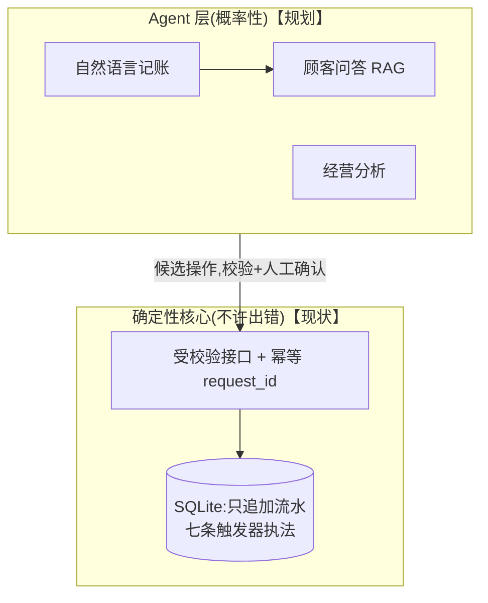

# barbershop-ledger

一家真实营业 20 年的县城理发店的储值会员账本:只追加、数据库触发器执法、LLM 永不直接写库。

> 状态(2026-10-25):**数据层完成**——四张 STRICT 表、七条业务触发器、全部规则经实测与一轮外部对抗评审 | 后端开发中 | 2027-01 旺季前与旧系统完成切换

## 为什么有这个仓库

这不是课程 demo。用户是一位真实的店主(我母亲),单人操作;替换的是一套用了 13 年、7 万多笔真实流水的旧单机软件;上线窗口由春节旺季决定。卡里的余额是她欠顾客的"债",所以数据迁移、只追加、可对账是这个系统的第一性设计,功能反而是其次。完整的设计推理见 [DESIGN.md](DESIGN.md)。

## 现在能跑什么

```bash
git clone https://github.com/z272065/barbershop-ledger.git
cd barbershop-ledger
python demo.py        # 仅依赖 Python 标准库,SQLite >= 3.37
```

`demo.py` 从 schema.sql 现建一个内存库,跑 17 个场景——合法的完整生命周期(迁移期初→充值→消费→红字冲正→退卡清零),加上每一种数据库该拦下的坏数据:

```
PASS [⑦ 余额不足的扣卡(不存在扣到清零)] 预期拦 -> 拦: 余额不足
PASS [⑩ 野生红字:冒充负数消费凭空加钱] 预期拦 -> 拦: 消费金额必须等于金额变动/消费金额必须大于0
PASS [⑯ 同一笔冲第二次(一笔只能一冲)] 预期拦 -> 拦: 原行已被冲过
对账:流水 8 行,有效笔数(正行-红字)= 4,全部 17 个场景 PASS
```

## 架构



## 三条核心决策

1. **LLM 永不直接写库**——幻觉在账本上是资金事故;LLM 输出不可审计不可回滚;注入实验证明防御必须做在写入权限层。
2. **账本只追加,规则由数据库执法**——错账=红字冲正,历史永远留着;金额/期初/镜像/余额规则全部是触发器,改规则不碰数据。
3. **余额不存列,幂等进结构**——余额=流水现算,缓存分叉问题从结构上不存在;request_id 唯一约束把双击与网络重试挡在库层。

推理过程见 [DESIGN.md](DESIGN.md),建库脚本见 [schema.sql](schema.sql)。

## 如何构建

schema 与触发器由我手写;另由 AI 承担对抗评审——一轮外部评审找出的三个 P0 漏洞(冒充负数行凭空加钱、REPLACE 绕过禁删、IGNORE 静默吞违规行)全部修复并转成了 demo.py 里的回归场景。评审→复现→修复的完整过程在提交历史里。

## 安全

顾客手机号属个人信息:不明文外泄、不导出、可删除。真实经营数据永不进入本仓库;仓库内脚本全部基于内存库从 schema.sql 现建。

## 说明

作品集项目:真实用户使用中(2026-12 起双轨),非通用产品。后端(FastAPI)与部署记录将在后续提交中补齐。
