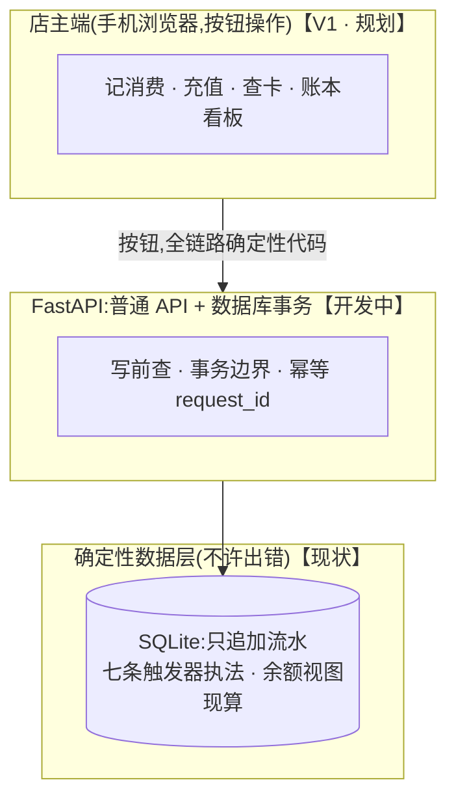

# barbershop-ledger

一家真实营业 20 年的县城理发店的储值会员账本:流水只追加、数据库触发器执法、系统里没有任何概率性组件。

> 状态(2026-10-29):**数据层完成**——四张 STRICT 表、七条业务触发器、余额视图 v_balance、27 个测试场景覆盖全部 18 条拦截规则 | 后端开发中 | 计划 2026-11 中旬起店主试用并进入双轨对账,对账零差错即切换;旺季前没达标就带着双轨过春节、年后切换

## 为什么有这个仓库

这不是课程 demo。用户是一位真实的店主(我母亲),单人操作;替换的是一套用了 13 年、71032 行真实流水的旧单机软件;卡里的余额是她欠顾客的"债",所以数据迁移、只追加、可对账是这个系统的第一性设计,功能反而是其次。完整的设计推理见 [DESIGN.md](DESIGN.md)。

## 现在能跑什么

```bash
git clone https://github.com/z272065/barbershop-ledger.git
cd barbershop-ledger
python demo.py            # 27 个场景,覆盖全部 18 条拦截规则
python tx_idempotency_test.py   # 事务边界与幂等语义
```

仅依赖 Python 标准库,SQLite >= 3.37。`demo.py` 从 schema.sql 现建一个内存库:合法流是一位老会员的完整生命周期(迁移期初→充值→消费→红字冲正→退卡清零),拦截流给每条规则一个专属场景——判定标准是**报错文案与预期逐字一致**(不只是"被拦"),任一场景失败脚本以非零状态退出。期初窗口触发器的日期常量在内存库中调至远未来/过去,同时演示"窗口开着"与"窗口已关"两种状态,schema.sql 原文未动。

输出(节选):

```
PASS [⑥ 余额不足的扣卡(卡里只有 100,扣 120)] 预期拦「余额不足」 -> 拦: 余额不足
PASS [⑨ 野生红字:冒充负数消费凭空加钱(amount=-80/delta=+80)] 预期拦「消费金额必须等于金额变动/消费金额必须大于0」 -> 拦: 消费金额必须等于金额变动/消费金额必须大于0
PASS [⑱ 割接窗口已关后补导期初(触发器读数据库时钟,倒填日期无效)] 预期拦「迁移期初窗口已关」 -> 拦: 迁移期初窗口已关
PASS [㉒ 假镜像:金额没翻对(该 -10000 写成 -100)] 预期拦「不是精确镜像」 -> 拦: 不是精确镜像
对账:流水 9 行,有效笔数(正行-红字)= 5,场景通过 27/27
```

`tx_idempotency_test.py` 验证两条边界语义并带自动断言:RAISE 只回滚单条语句、事务边界由应用掌控;重放有两种形态(余额花光时先撞余额触发器、没花光时撞唯一索引),裸 INSERT 都拿不到原结果——所以幂等必须"写前查",重放返回原结果、绝不二次扣款。

## 架构



## 三条核心决策

1. **系统里没有 LLM——原设计的 Agent 层整层砍了**——记账必须确定性,店主端全部是按钮触发的普通代码;三个原 V3 功能(自然语言记账/顾客问答/经营分析)的砍除理由见 [DESIGN.md](DESIGN.md)。LLM 工程能力由我的另一个项目([rag-policy-qa](https://github.com/z272065/rag-policy-qa))证明:里面的提示注入实验(n=10,单次)显示,带权威口吻的假前提 9/10 能把模型带偏——这也是概率性组件不碰账本的实证依据。
2. **账本只追加,规则由数据库执法**——错账=红字冲正,历史永远留着;金额/期初/镜像/余额规则全部是触发器,改规则不碰数据。拦截 UPDATE/DELETE 的触发器按计划在割接前安装(现为应用层写入纪律)。
3. **余额不存列,幂等进结构**——余额=流水现算,缓存分叉问题从结构上不存在;request_id 唯一约束+写前查把双击与网络重试挡在库层。

推理过程见 [DESIGN.md](DESIGN.md),建库脚本见 [schema.sql](schema.sql)。

## 如何构建

schema 与触发器由我手写;另由 AI 承担对抗评审。一轮外部评审找到的三个严重漏洞,修复落点如下:

| 评审发现的漏洞 | 修复落点 | 证明场景 |
|---|---|---|
| 冒充负数消费行凭空加钱 | schema 触发器(类型门票+金额方向) | demo 场景⑨ |
| INSERT OR REPLACE 绕过禁删触发器 | 连接开关 recursive_triggers=ON + 后端禁用该写法 | 写入纪律已定,后端代码落地后补场景 |
| INSERT OR IGNORE 静默吞掉违规行 | 后端禁用该写法,幂等改为写前查 | tx_idempotency_test.py 2b |

测试的判定标准与"评审→修复"同源:拦截场景要求报错文案与预期逐字一致,删掉或改坏任何一条规则,对应场景立刻变红、脚本以非零状态退出。

## 安全

顾客手机号属个人信息:不明文外泄、不导出、可删除。真实经营数据永不进入本仓库;仓库内脚本全部基于内存库从 schema.sql 现建。

## 说明

作品集项目:真实用户为店主本人(作者母亲),计划 2026-11 中旬起店主试用、随后双轨对账,非通用产品。后端(FastAPI)与部署记录将在后续提交中补齐。
